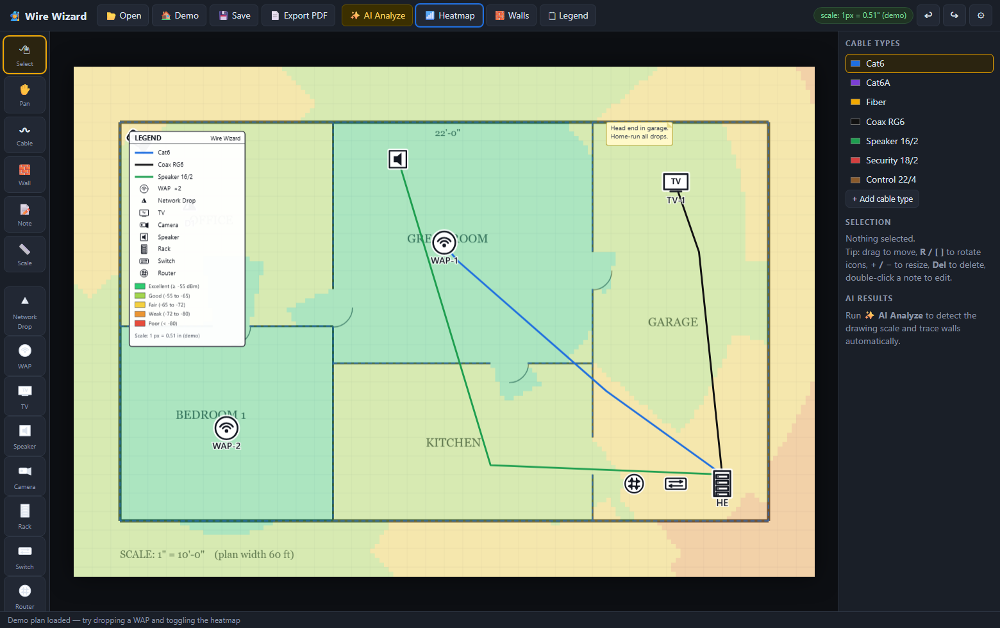

# 🧙 Wire Wizard

**Floorplan markup for low-voltage contractors.** Open a floorplan PDF or image,
draw color-coded cable runs, drop rotatable device icons, let Claude read the
drawing to find the scale and trace the walls, generate a WiFi heatmap, add
notes, auto-build a legend, and export a clean marked-up PDF for the customer.

**Download:** [dsio.io/wirewizard](https://www.dsio.io/wirewizard) — portable
Windows exe, no install, no admin rights.



## What it does

- **Opens PDFs and images** (PDF · PNG · JPG · WebP · BMP). Multi-page PDFs get per-page markup.
- **Cable runs** — click-to-draw polylines in the color of the cable type
  (Cat6, Cat6A, Fiber, Coax RG6, Speaker, Security, Control out of the box —
  rename, recolor, or add your own). Run length shown in feet once scale is set.
- **Device icons** — Network Drop (the standard **two-tone triangle** data-outlet
  symbol), WAP, TV, Speaker, Camera, Rack, Switch, Router. All rotatable
  (R / [ ] keys or the buttons), resizable, and labelable.
- **AI Analyze** ✨ — sends the page to Claude, which reads the scale bar /
  dimension strings and traces wall segments. Scale feeds run lengths and the
  heatmap; walls feed the heatmap's attenuation model.
- **WiFi heatmap** 📶 — free-space path loss + per-wall attenuation from every
  WAP icon on the page. Tunable (dB per wall, path-loss exponent, AP power)
  in Settings. Bands from Excellent (≥ -55 dBm) to Poor (< -80).
- **Scale tool** 📏 — no AI needed: draw along any known distance and type the
  real length.
- **Notes** — sticky-note annotations, double-click to edit.
- **Legend** 🗒 — auto-generated from what's actually on the drawing: cable
  colors, icon meanings with counts, heatmap bands, and the scale. Drag it
  anywhere; it's stamped on the export.
- **Export PDF** 📄 — the original drawing with everything composited, one page
  per source page.
- **Projects** — save/reopen `.wirewiz` files with all markup intact.

## AI setup

Settings (⚙) → paste a Claude API key from
[platform.claude.com](https://platform.claude.com/). The key is stored locally
only. Alternatively, if you're logged in with the Anthropic CLI
(`ant auth login`), leave the field empty — the app picks up your account
automatically. Everything except AI Analyze works fully offline.

## Keyboard

| Key | Action |
|---|---|
| V / H / L / W / N / S | Select / Pan / Cable / Wall / Note / Scale |
| Space (hold) | Pan |
| Enter / double-click / right-click | Finish cable run |
| R, [ , ] | Rotate selected icon |
| + / − | Resize selected icon |
| Del | Delete selection |
| Ctrl+Z / Ctrl+Y | Undo / redo |
| Ctrl+O / Ctrl+S / Ctrl+E | Open / Save project / Export PDF |

## Development

```bash
npm install
npm start          # Electron app
npm run serve      # browser mode at http://127.0.0.1:8151
npm run smoke      # Playwright end-to-end test
npm run dist       # build portable Windows exe into dist/
```

The renderer is dependency-light vanilla JS on a single canvas; pdf.js loads
floorplans, jsPDF writes the export, and the Claude call runs in the Electron
main process via the official SDK.
